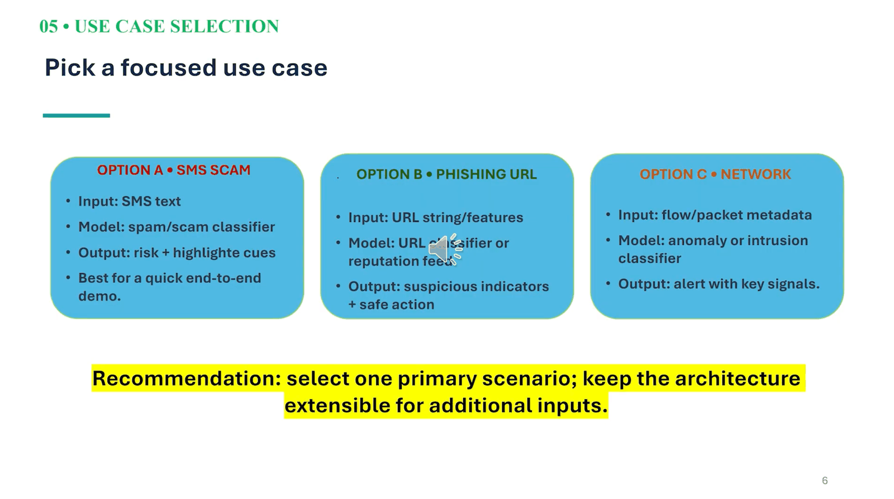
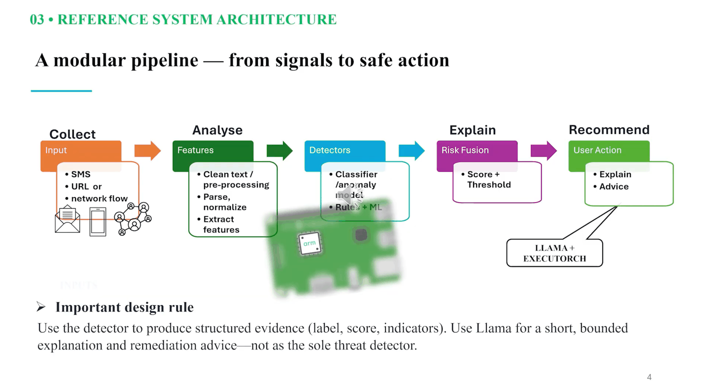
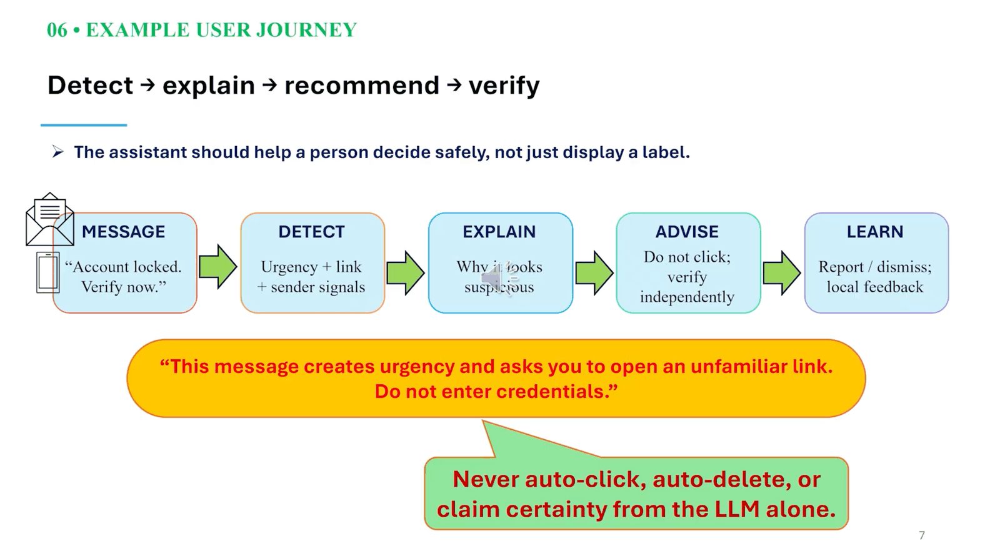
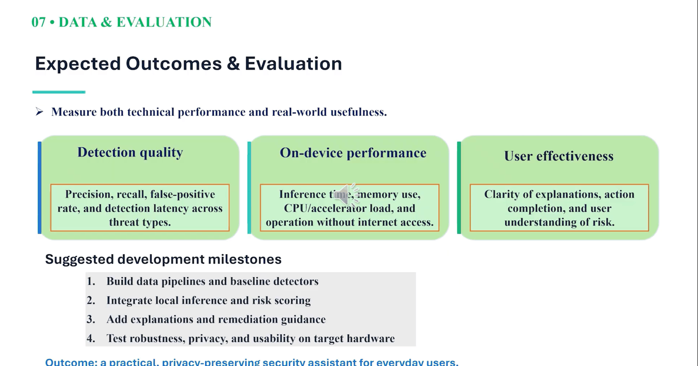
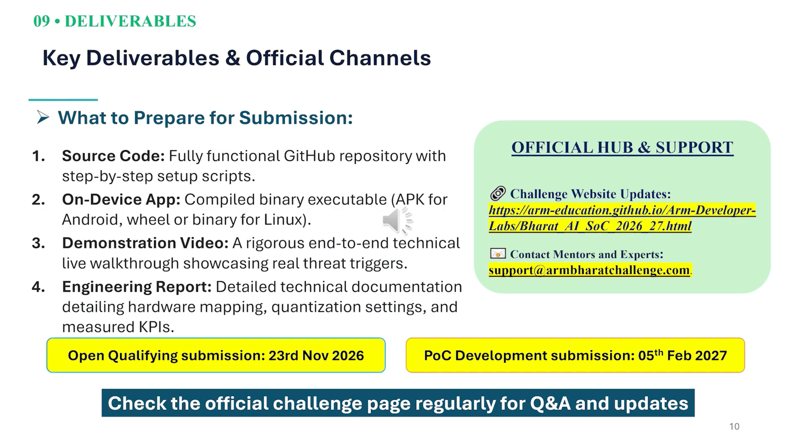

# Build Plan: PS3 On-Device Network Safety Assistant

Everything here is drawn from the official PS3 brief ([PDF](docs/SoC%20Hackathon%20Details.pdf)) and walkthrough video ([transcript](docs/PS3_Transcript.txt)). Items marked **(brief)** are requirements from the challenge. Everything else is our proposal and is open for discussion.

---

## 1. Scope

### Primary use case: Option C, home network monitoring



The brief says to *"select one primary scenario; keep the architecture extensible for additional inputs"* **(brief)**. We're proposing **Option C (Network)** because:

- It's what the team was already leaning towards, and a Pi is a natural "edge appliance" for it (the brief lists *Arm Linux, service-style monitoring / UI* as a target).
- We can stage realistic, **repeatable attacks offline** on our own LAN, which the demo video needs.
- The DNS lookups we capture give us a cheap route into **Option B (phishing domains)** later, with no new input source.

**Trade-off to be aware of:** the brief calls Option A (SMS) *"best for a quick end-to-end demo"*. Option C is harder: we have to build a capture setup, and public datasets don't match home traffic well. The timeline below front-loads that risk. If capture or detection is still shaky by **9 Nov**, we fall back to A or B. The detection → fusion → Llama → UI half of the pipeline carries over unchanged.

### In scope for Phase 1 (23 Nov)
- Pi 5 acting as the Wi-Fi access point for a small test network
- Flow-metadata capture, rule detectors, one ML flow detector, risk fusion
- Llama explanation + remediation advice via ExecuTorch on the Arm CPU
- Local web UI with alerts, explanations, user-confirmed actions and feedback
- Benchmarks, offline demo video, engineering report

### Deferred to Phase 2 (5 Feb)
- Phishing-domain/URL detector on captured DNS (Option B)
- Hailo AI HAT path for the ML detector
- Learning from user feedback (per-household baseline / allowlists)
- Larger user study

### Explicitly not doing
- **Using the LLM as the detector.** The brief says Llama is *"not the sole threat detector"* **(brief)**.
- **Automatic actions.** The brief says *"Never auto-click, auto-delete, or claim certainty from the LLM alone"* **(brief)**. Blocking or disconnecting a device always needs a user click.
- **Deep packet inspection of payloads.** We work on metadata only, which is better for privacy and works with TLS.

---

## 2. Architecture



```
 devices ──Wi-Fi──► [ Raspberry Pi 5: access point + NAT ] ──► internet (optional)
                              │
   ┌──────────────────────────┼──────────────────────────────────────────┐
   │ COLLECT   packet metadata, DNS queries, ARP/DHCP events             │
   │    ▼                                                                │
   │ ANALYSE   flow aggregation → feature vectors; device inventory      │
   │    ▼                                                                │
   │ DETECT    rules engine  +  ML flow classifier / anomaly model       │
   │    ▼        (CPU, or Hailo NPU via HailoRT: separate pipeline)       │
   │ FUSE      risk score + threshold, de-dup, evidence JSON             │
   │    ▼                                                                │
   │ EXPLAIN   Llama (ExecuTorch, Arm CPU): bounded explanation + advice │
   │    ▼                                                                │
   │ UI        local web dashboard: alert → explain → act → feedback     │
   └─────────────────────────────────────────────────────────────────────┘
```

### 2.1 Collect: how the Pi sees traffic
**Proposal:** the Pi runs its own Wi-Fi access point (hostapd + dnsmasq + NAT), and test devices join it. This gives us:
- full visibility of every connected device's traffic, DNS lookups and DHCP joins
- a self-contained network that **works with the uplink unplugged**, which is what the offline demo needs **(brief)**

Alternatives, if the AP approach causes trouble: port mirroring on a managed switch, or DNS-only visibility (Pi as the network's DNS server).

### 2.2 Analyse: features
- **Flow features:** duration, packet/byte counts in each direction, rates, inter-arrival times, flags, distinct ports and hosts contacted. These should be compatible with the feature sets of public IDS datasets so we can train on them.
- **Context events:** new MAC seen (DHCP), IP→MAC changes (ARP), DNS queries per device.
- Tooling candidates: `nfstream` / `scapy` / `tshark`. We'll pick one in week 1 after testing which runs well on the Pi.

### 2.3 Detect: rules + ML
Rules give precise, explainable evidence. ML covers the patterns we didn't write rules for.

| Detector | Signal | Type |
|---|---|---|
| Port / host scan | many distinct ports or hosts in a short window | rule |
| Brute-force login | repeated short connections to SSH/RDP/telnet/HTTP-auth ports | rule |
| ARP spoofing | gateway IP announced by a new MAC | rule |
| New / unknown device | first-seen MAC on the network | rule (info-level) |
| Known-bad destination | DNS/IP matches an **offline, locally stored** blocklist | rule |
| Suspicious domains | high-entropy / DGA-like names, beaconing at regular intervals | rule/heuristic |
| Malicious flow | flow classifier (e.g. gradient-boosted trees or a small MLP) trained on public IDS data | ML |
| Unusual behaviour | anomaly model (e.g. isolation forest / autoencoder) fit on our own normal traffic | ML |

**Candidate datasets:** CIC-IDS2017, UNSW-NB15, CIC-IoT2023. Public datasets don't look like home traffic, so we'll also record our own benign traffic and our own attack runs, and evaluate on those.

**About "dropped incoming connections":** this was in the old README. Unsolicited inbound connections hit every internet-facing network constantly, so on their own they would flood users with alerts and wreck our false-positive rate, which is a judged metric **(brief)**. We'll log them as a low-weight signal that only counts in combination (e.g. the same source probing persistently, or showing up alongside other evidence).

### 2.4 Risk fusion
- Each detector emits `{detector, label, score, indicators[]}`.
- Fusion combines these into one risk score per device per time window, applies a threshold, and suppresses duplicates.
- Output is a structured **evidence record**, the only thing Llama sees:

```json
{
  "device": {"name": "Living-room TV", "ip": "192.168.4.23", "mac": "aa:bb:…", "first_seen": "…"},
  "threat": "port_scan",
  "risk": 0.87,
  "severity": "high",
  "indicators": ["contacted 412 ports on 3 hosts in 20 s", "source is a device first seen 5 min ago"],
  "detectors": [{"name": "rule.port_scan", "score": 0.95}, {"name": "ml.flow_clf", "score": 0.71}],
  "window": {"start": "…", "end": "…"}
}
```

### 2.5 Explain & recommend: Llama + ExecuTorch
- **Model:** Llama 3.2 1B Instruct to start, quantised for ExecuTorch (XNNPACK backend on the Arm CPU). We'll try 3B if latency and RAM allow.
- **Bounded output** **(brief: "short, bounded explanation")**: a fixed prompt template, a cap on output tokens, and a fixed answer shape:
  1. **What happened** (one or two sentences, no jargon)
  2. **Why it matters**
  3. **How confident we are**, taken from the fusion score and never invented by the LLM
  4. **What to do**: verify / disconnect / block / report. Actions only become UI buttons if they come from an allowlist.
- **Guardrails:** Llama only sees the evidence JSON, never raw traffic. If its output fails validation or times out, we show a templated explanation instead.

### 2.6 User interface
- Local web app served by the Pi (e.g. FastAPI + a lightweight frontend), reachable from any phone or laptop on the network.
- Screens: device list, live alert feed, alert detail (explanation + evidence + actions).
- Every action needs user confirmation. **Report / dismiss** is recorded locally as feedback (the "LEARN" step in the brief's user journey).



### 2.7 Hardware mapping
| Component | Phase 1 | Phase 2 (if AI HAT) |
|---|---|---|
| Capture, features, rules, fusion, UI | Pi 5 Arm CPU | Pi 5 Arm CPU |
| ML flow detector / anomaly model | Pi 5 Arm CPU | Hailo NPU via HailoRT (NN models only; tree models stay on CPU) |
| Llama explainer | Pi 5 Arm CPU via ExecuTorch | **unchanged**: Arm CPU via ExecuTorch |

The brief says to *"keep the Arm CPU path clear; document any accelerator separately"* **(brief)**. The CPU-only build stays our reference baseline.

---

## 3. Evaluation plan



### Detection quality **(brief)**
- **Metrics:** precision, recall, false-positive rate and detection latency, **per threat type**.
- **Offline test set:** a held-out split of the public dataset(s).
- **Live test set:** scripted attack scenarios on our own network, run several times each, plus hours of normal household traffic to measure false positives.
- **Scenario scripts** (all on our own isolated network): nmap scans, SSH brute force against a test box, ARP spoofing, a new rogue device joining, DNS lookups to blocklisted and DGA-style domains, periodic beaconing.

### On-device performance **(brief)**
- Llama: model load time, time-to-first-token, tokens/sec, peak RAM.
- Detectors: per-flow inference time, throughput.
- End-to-end: time from attack start to alert shown in the UI.
- System: CPU/accelerator load and temperature during sustained monitoring.
- **Every run records:** device/OS • model & quantisation • ExecuTorch version • latency • memory • offline yes/no **(brief)**.

### User effectiveness **(brief)**
- A small study with 5–10 non-technical people (family, friends, non-CS students).
- Show each person a few alerts, then ask them to explain the risk back and choose an action.
- Measure: comprehension (correct or not), action completion, clarity rating (1–5), and time to decide.
- Compare **Llama explanation vs. raw detector label** to show the explanations actually help.

---

## 4. Timeline

The brief's suggested milestones are: **(1)** data pipelines + baseline detectors → **(2)** local inference + risk scoring → **(3)** explanations + remediation → **(4)** robustness, privacy and usability testing on target hardware **(brief)**.

Today is 29 Oct, which leaves **~3.5 weeks to Phase 1**. The biggest unknown is getting Llama running under ExecuTorch on the Pi, so it starts on day 1, in parallel with everything else.

| Week | Dates | Goals | Exit check |
|---|---|---|---|
| **1** | 29 Oct – 4 Nov | Pi 5 set up as an AP. Capture → flow features working. **Llama 1B running via ExecuTorch on the Pi** with first latency/RAM numbers. Datasets downloaded. Evidence JSON schema agreed. | `curl` an evidence JSON → Llama answers on the Pi, offline |
| **2** | 5 – 11 Nov | Rule detectors + ML flow classifier trained and running live. Risk fusion. Attack scenario scripts. **Go/no-go on Option C by 9 Nov.** | Live scan from a laptop → fused alert in logs |
| **3** | 12 – 18 Nov | Llama prompt + output validation + fallback. Web UI. Feedback storage. Full benchmark suite. | End-to-end demo works with the uplink unplugged |
| **4** | 19 – 23 Nov | Mini user study. Fix false positives. Setup scripts + wheel/binary. Record demo video. Write engineering report. **Submit by 22 Nov** (one day buffer). | All 4 deliverables uploaded |
| Phase 2 | 24 Nov – 5 Feb | Option B domain/URL detector, Hailo NPU path, per-household baseline from feedback, bigger user study, polish. | PoC submission |

### Workstreams (owners TBD)
1. **Capture & detection:** AP setup, feature extraction, rules, ML training, fusion
2. **LLM & on-device:** ExecuTorch export/quantisation, prompts, validation, benchmarks
3. **App & evaluation:** web UI, packaging/setup scripts, user study, demo video, report

---

## 5. Deliverables checklist **(brief)**



- [ ] **Source code:** working GitHub repo with *step-by-step setup scripts*
- [ ] **On-device app:** compiled build for Linux (*wheel or binary*)
- [ ] **Demo video:** *rigorous end-to-end live walkthrough showcasing real threat triggers*, on the Pi, offline
- [ ] **Engineering report:** *hardware mapping, quantisation settings, measured KPIs*, plus the hardware setup and model configuration

---

## 6. Proposed repo structure

```
├── README.md
├── PLAN.md
├── setup/              # Pi provisioning: AP config, dependencies, model download/export
├── capture/            # packet/flow capture, device inventory
├── detectors/
│   ├── rules/
│   └── ml/             # training notebooks/scripts, exported models
├── fusion/             # risk scoring, evidence records
├── explainer/          # ExecuTorch Llama runner, prompts, output validation
├── app/                # web UI + API
├── scenarios/          # attack simulation scripts (own network only)
├── bench/              # benchmark harness + results
├── report/             # engineering report sources
├── docs/               # official challenge material
└── assets/docs/        # images for docs
```

---

## 7. Risks & mitigations

| Risk | Mitigation |
|---|---|
| ExecuTorch Llama build/export issues on the Pi | Start day 1. Use the official ExecuTorch Llama example flow. Fall back to the smallest Llama 3.2 model. |
| Public IDS models don't transfer to home traffic (high false positives) | Rules carry the demo. Use ML as supporting evidence. Calibrate thresholds on our own benign captures. |
| LLM output too slow for "real-time" | Explanation is generated asynchronously: the alert appears instantly, and the explanation streams in. Cap tokens. Cache explanations for repeat alert types. |
| LLM hallucinates or overstates certainty | It only sees the evidence JSON. Confidence comes from fusion. Output is schema-validated with a templated fallback. |
| Capture setup eats the schedule | Go/no-go on 9 Nov, then pivot to Option A/B and reuse the rest of the pipeline. |
| Running attack tools on a network we don't own | Only run scenarios on our own isolated AP network. |
