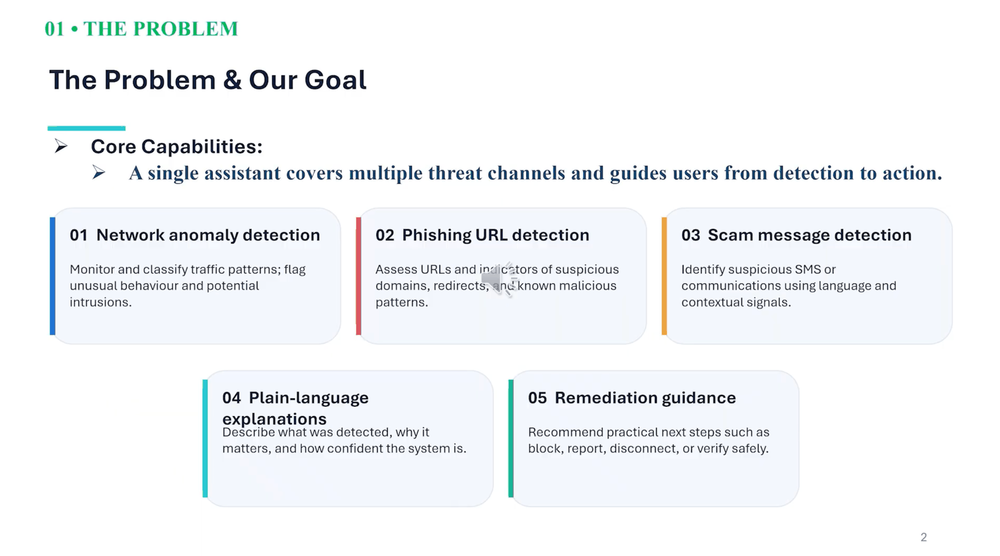
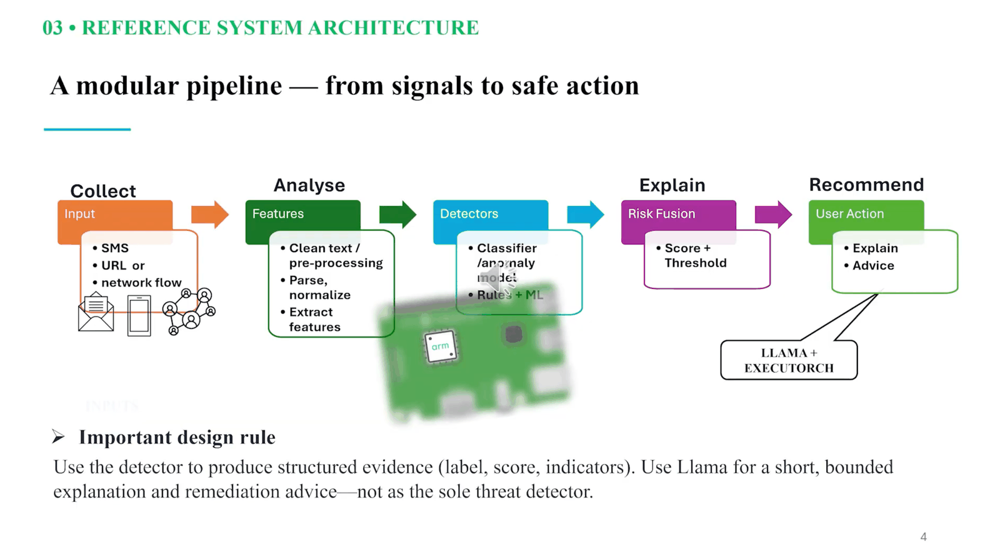
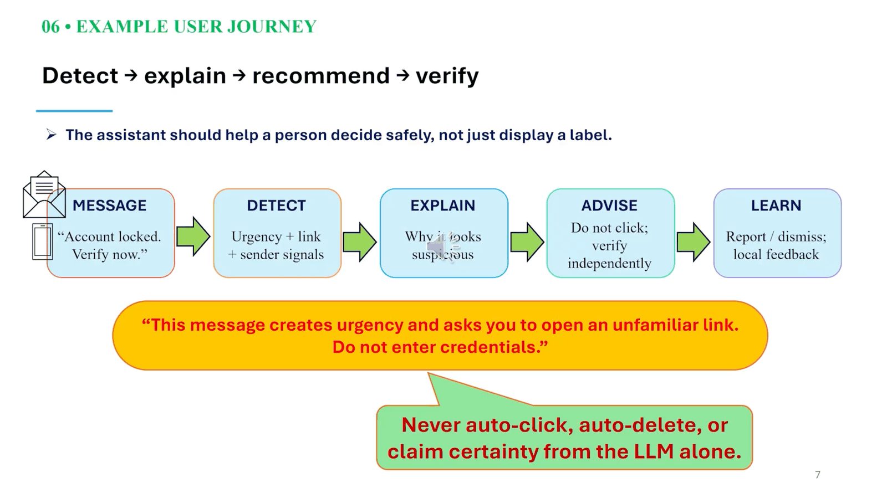
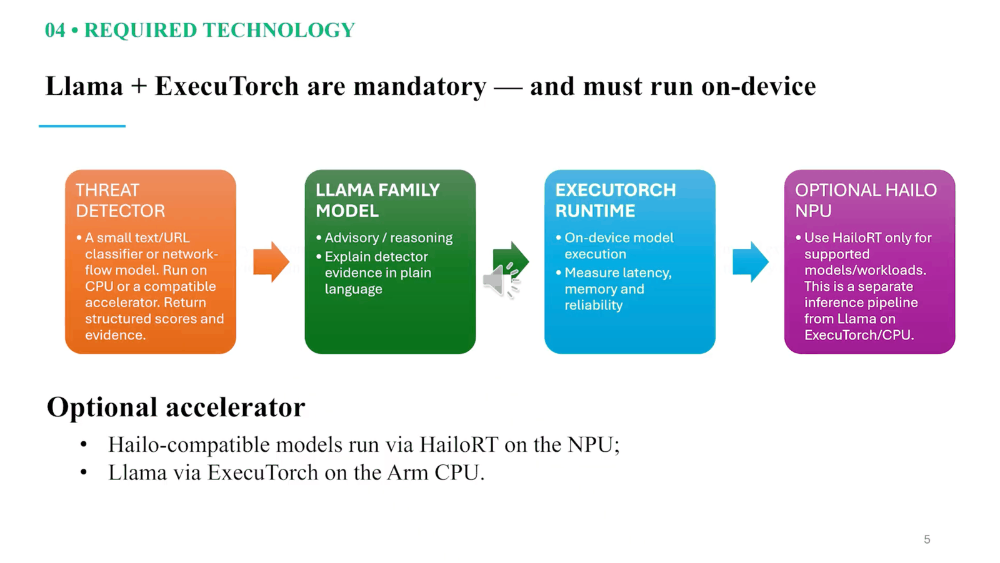
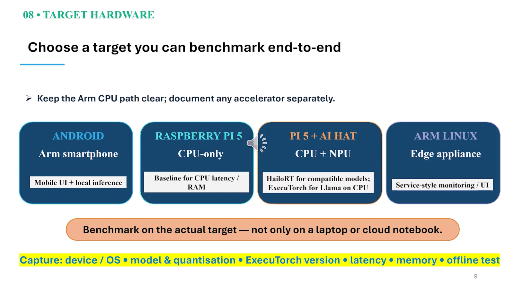
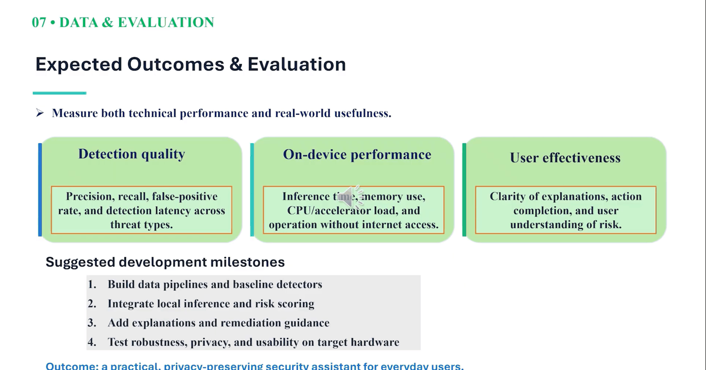

# ARM-Bharat-Challenge

Our team repo for the **Bharat AI-SoC Challenge 2026–27**, PS3: *Cybersecurity & Digital Safety: on-device threat detection, clear explanations, and actionable protection*.

> **Status:** planning. See **[PLAN.md](PLAN.md)** for the full build plan, timeline and evaluation strategy.

## What we're building

A **home-network safety assistant on a Raspberry Pi 5**. Devices connect through the Pi. It watches traffic metadata, flags suspicious activity, and tells the household **what happened, why it matters, how sure it is, and what to do next**, all in plain language. Everything runs on the Pi with no cloud, and it keeps working with the internet unplugged.

This is **Option C (Network)** from the problem statement. The design is modular, so other inputs can be added later. Phishing-domain checks on the DNS lookups we already see (Option B) are the natural next step.



## How it works

We follow the reference pipeline from the problem statement:



| Stage | What it does in our system | Runs on |
|---|---|---|
| **Collect** | Capture flow/packet metadata (plus DNS, ARP and DHCP events) from devices on the Pi's network | Pi CPU |
| **Analyse** | Aggregate packets into flows and extract features (ports, rates, sizes, timing, destinations) | Pi CPU |
| **Detect** | Rules for known-bad patterns (port scans, brute force, ARP spoofing, new devices, bad domains) and a small ML flow classifier/anomaly model | Pi CPU, or Hailo NPU if we use the AI HAT |
| **Risk fusion** | Combine detector outputs into one risk score + threshold, de-duplicate, build a structured evidence record | Pi CPU |
| **Explain & recommend** | **Llama (via ExecuTorch)** turns the evidence into a short explanation and next steps | Pi Arm CPU |
| **User action** | Local web UI: read the alert, take action (verify / disconnect / block, always user-confirmed), dismiss or report as feedback | Pi CPU |

**The key design rule:** detectors decide *whether* something is a threat. Llama only *explains* the evidence and suggests actions. It is never the detector, and the system never acts automatically or claims certainty from the LLM alone.



## Challenge requirements (from the PS3 brief)

**Mandatory**
- A **Llama-family model**, run **on-device with ExecuTorch**
- Runs on **real Arm hardware**. Benchmark on the target device, not a laptop or cloud notebook
- Works **fully offline**
- Pick **one primary use case** and keep the architecture extensible

**Optional accelerator.** If we use a Pi 5 + AI HAT, Hailo-compatible models run on the NPU via **HailoRT**, while Llama stays on the Arm CPU via ExecuTorch. These are **two separate pipelines**, and we document which model runs where.



**Target hardware:** Raspberry Pi 5 (CPU-only baseline first; AI HAT is a stretch goal).



## How we'll be evaluated

| Area | Metrics |
|---|---|
| **Detection quality** | Precision, recall, false-positive rate, detection latency across threat types |
| **On-device performance** | Inference time, memory use, CPU/accelerator load, operation without internet |
| **User effectiveness** | Clarity of explanations, action completion, user understanding of risk |

For every benchmark we record: **device/OS • model & quantisation • ExecuTorch version • latency • memory • offline test**.



## Deliverables

1. **Source code:** this repo, with step-by-step setup scripts
2. **On-device app:** a compiled build for Linux (Python wheel or binary)
3. **Demo video:** end-to-end live walkthrough on the Pi, offline, with real threat triggers
4. **Engineering report:** hardware mapping, quantisation settings, measured KPIs

## Key dates

| Milestone | Date |
|---|---|
| Phase 1: Open qualifying submission | **23 Nov 2026** |
| Phase 2: PoC development submission (if shortlisted) | **5 Feb 2027** |

## Repo layout

```
├── PLAN.md            # build plan, timeline, evaluation
├── docs/              # official challenge material (brief PDF, video transcript)
└── assets/
    └── docs/          # slide screenshots used in this README
```

The code layout is proposed in [PLAN.md](PLAN.md#6-proposed-repo-structure).

## Team

- Pulkit Singla, Team Leader
- Akshit Sharma
- Ayushman Muduli
- Faculty Mentor: Dr. Sougata Sen

## Links

- [Challenge page](https://arm-education.github.io/Arm-Developer-Labs/Bharat_AI_SoC_2026_27.html): check regularly for Q&A and updates
- Mentor support: support@armbharatchallenge.com
- PS3 brief: [`docs/SoC Hackathon Details.pdf`](docs/SoC%20Hackathon%20Details.pdf) · video transcript: [`docs/PS3_Transcript.txt`](docs/PS3_Transcript.txt)
